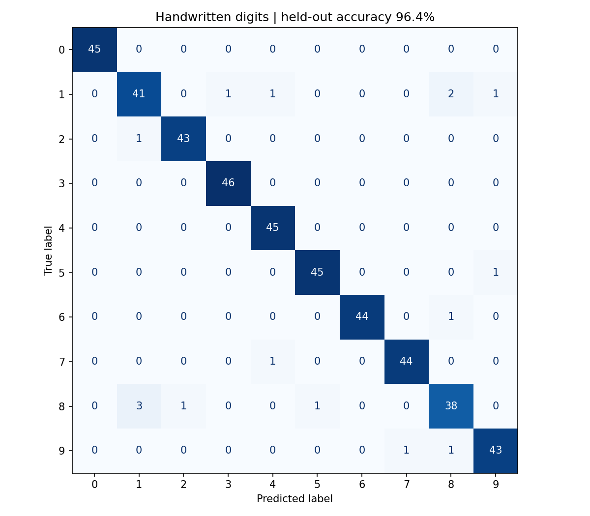

# Handwritten Digit Classification

Recognize digits 0-9 from real 8x8 grayscale images using a transparent logistic-classification pipeline.

شرح بالمصري في [EXPLAIN_AR.md](EXPLAIN_AR.md).

## Data

The scikit-learn Digits dataset contains 1,797 real handwritten-digit images, 64 pixel features
with values 0-16 and ten digit classes. It is the bundled copy of the UCI Optical Recognition
of Handwritten Digits test subset. Data description and original references are retained in
`data/dataset_description.txt`.

Source: https://scikit-learn.org/stable/modules/generated/sklearn.datasets.load_digits.html

No download, account or API key is needed after installing dependencies. No synthetic images are used.

## Method

1. Stratified 75/25 train/test split, random_state=42.
2. StandardScaler + LogisticRegression in one Pipeline, so preprocessing stays in training folds.
3. Five-fold stratified training CV selects C from 0.01, 0.1, 1 and 10 using macro F1.
4. Evaluate once on 450 held-out images and compare with a majority-class baseline.
5. Save predictions, per-class report, confusion matrix and actual misclassified examples.

The saved model is trained on training rows only, matching the reported metrics. No test-driven
tuning. Random splitting does not guarantee writer-disjoint evaluation. This is not a general
OCR system, and results on photographs, entire pages, new writers or Arabic-script digits
are unverified. Do not claim that coverage.

## Run

Use Python 3.10 or 3.11. Inside this folder:

```bash
python -m venv .venv
# Windows PowerShell activation:
.venv\Scripts\Activate.ps1
# macOS / Linux activation (use this instead of the Windows command):
source .venv/bin/activate
python -m pip install -r requirements.txt
python main.py
python predict.py --input outputs/sample_input.csv
```

Input CSV requires the 64 original columns `pixel_0_0` through `pixel_7_7`, row-major order,
with original pixel intensity values from 0 to 16. The sample contains five held-out feature rows.
The CLI prints predictions to stdout. Only load trusted joblib models because the pickle-based
format can execute code. Regenerate the model if package versions change.

## Files

- `main.py`: commented training/evaluation pipeline.
- `predict.py`: standalone CSV prediction CLI.
- `data/dataset_description.txt`: original loader source notes.
- `outputs/`: metrics, train/test row IDs, CV results, errors, plots and model.
- `requirements.txt`: tested direct versions.

## Actual reproduced results

### Handwritten digit results

- Dataset: 1,797 real digit images, 64 pixel features, ten classes (0-9).
- Train/test: 1347/450, stratified split, seed 42.
- Chosen C: 10.0; training five-fold CV macro F1: 0.967.
- Held-out accuracy: 0.964; macro F1: 0.964.
- Majority baseline accuracy: 0.102; macro F1: 0.019.

This is a classic small benchmark of 8x8 grayscale digits, not a general OCR system.
The random split does not guarantee different writers in training and test sets, and performance
on photos, full documents, Arabic-script digits or a new writer is unverified. No such coverage
is claimed. Features remain inside a training-only scaling pipeline. Model selection uses
training CV; the held-out split is used for final evaluation only. Saved model uses training
rows only, matching these metrics. Error examples are intentionally shown, not hidden.


## Verify and extend

The review bundle includes the shared integration tests. For this standalone repository, run `python main.py` to reproduce its metrics.
Study the error examples and explain the confusion pairs before adding another model.
A useful next step is a genuinely writer-disjoint or externally collected test set,
not repeatedly tuning against these held-out images.

## Bundled data and reports

Real datasets and generated reports are compressed in the root `9-project-assets.zip` file.
`resources.py` verifies its SHA-256 and extracts it automatically the first time you run
`main.py` or the dashboard. No web request is made. A numeric prefix on the archive filename
is harmless and supported. You can also run `python resources.py` explicitly before browsing
the output images locally. Saved joblib models are not published; run main.py to train them.
The full data-source notes and original notices remain inside the archive.

## Project preview


